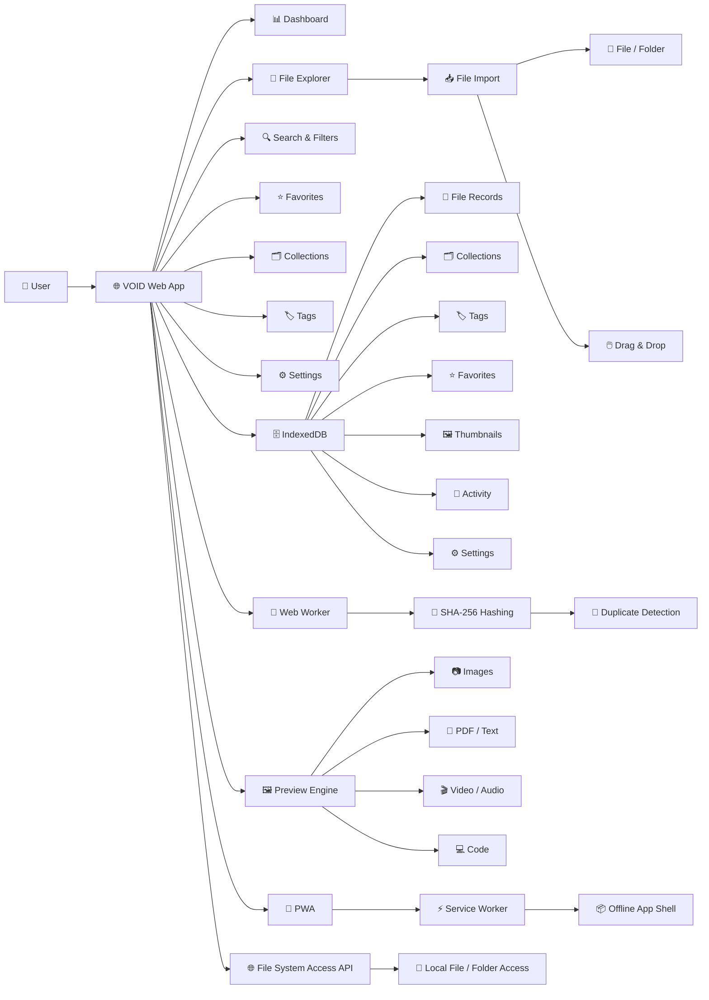
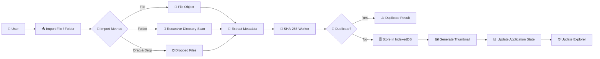
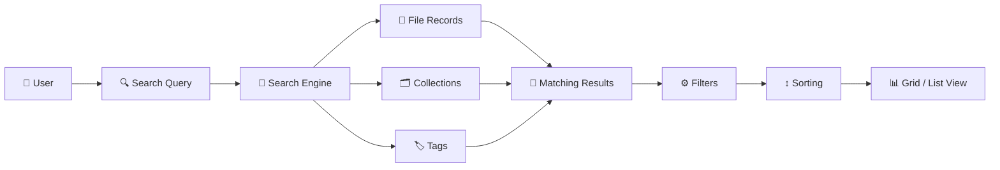
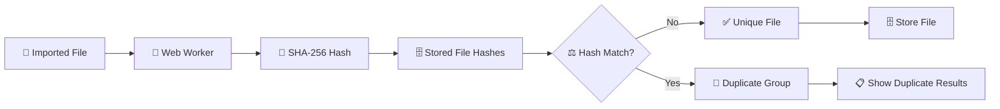
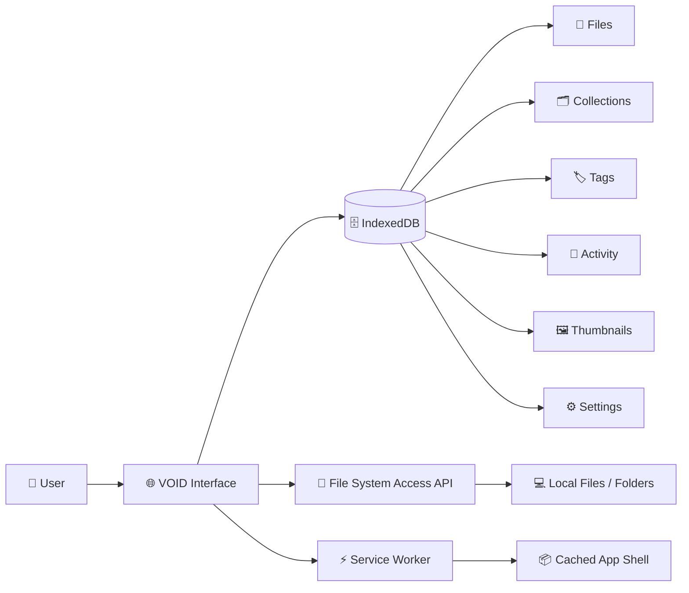
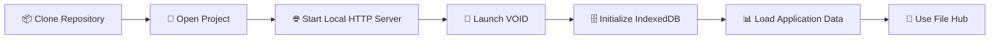
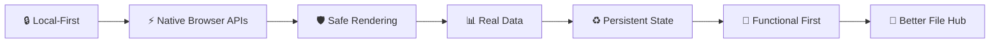
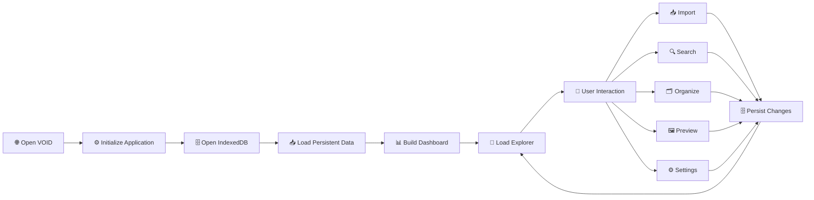

# 🗂️ VOID — Personal Browser File Hub

VOID is a modern **local-first personal file hub** designed to provide a smarter, organized space for everything you store in your browser.

It provides file importing, folder management, previews, search, favorites, collections, tags, duplicate detection, storage analytics, and offline support — while keeping file data inside the user's browser storage instead of relying on a traditional backend or cloud upload system.

---


## 🔗 Live Demo & Repository

🌐 **Live Demo:** [VOID — Live](https://void-pjtc.onrender.com/)

💻 **GitHub Repository:** [VOID — GitHub](https://github.com/ManjeetPrabhakarRawat/VOID-Personal-Browser-File-Hub)

---

## 🚀 Features

### 📁 File Management

- Import individual files
- Import complete folders
- Drag & drop file importing
- Persistent browser-based file storage
- File metadata management
- Remove files from VOID
- Bulk file actions
- File organization

### 🖼️ File Previews

VOID provides preview support for multiple file categories:

- 🖼️ Images
- 📄 PDF documents
- 📝 Text files
- 💻 Source code
- 🎬 Videos
- 🎵 Audio files
- 📦 Unsupported file types with safe fallback states

Imported HTML, JavaScript, and other active-content files are treated as **source content** and are never executed inside the application.

### 🔍 Search & Discovery

- Global file search
- File-type filtering
- Sorting
- Recent files
- Favorites
- Collections
- Tags
- Duplicate detection
- Grid view
- List view

### 🧬 Duplicate Detection

VOID uses **SHA-256 content hashing** to identify files with identical content.

Duplicate scanning is performed using a Web Worker so that hashing work does not unnecessarily block the main interface.

### ⭐ Favorites

Users can mark files as favorites for quick access.

Favorite state is persisted in browser storage and remains available after page reloads.

### 🗂️ Collections

Create logical groups of files using collections.

Collections allow users to organize related files without physically moving or duplicating the original file data.

### 🏷️ Tags

Files can be organized using custom tags.

Tags provide another flexible way to categorize and quickly discover files.

### 📊 Storage Analytics

VOID provides storage information based on actual application data.

The storage area includes information such as:

- Total stored files
- Used browser storage
- File categories
- Storage distribution
- Thumbnail/cache usage

No fake dashboard values are used.

### ⚙️ Settings

VOID includes configurable application settings for:

- Default explorer view
- Theme
- Thumbnail behavior
- Reduced motion
- Import behavior
- Managed/reference storage preference
- Cache cleanup
- Storage information
- Keyboard shortcuts
- Metadata export
- Application data clearing

### 📱 Responsive Interface

- Desktop-first file management experience
- Responsive layouts
- Mobile navigation support
- Grid/List explorer views
- Keyboard accessibility
- Reduced-motion support

### 📦 Progressive Web App

VOID includes a PWA/offline shell so the application interface can remain available when the browser is offline.

---

## 🛠️ Technology Stack

### 🎨 Frontend

- HTML5
- CSS3
- Vanilla JavaScript
- CSS Grid
- Flexbox
- Responsive Design
- Modern Web APIs

### 🗄️ Browser Storage

- IndexedDB
- Browser Storage APIs

### ⚡ Browser APIs

- File System Access API
- File & Directory APIs
- Drag & Drop API
- Web Crypto API
- URL/Object URLs
- Media APIs

### 🧵 Background Processing

- Web Workers
- SHA-256 hashing

### 📱 Progressive Web App

- Web App Manifest
- Service Worker
- Offline caching

---

# 🏗️ Architecture



---

## 🔄 File Import Flow



---

## 🔍 Search & Discovery Flow



---

## 🧬 Duplicate Detection Flow



---

## 💾 Local-First Data Flow



---

# 📁 Project Architecture

```text
VOID/
│
├── index.html
│
├── manifest.webmanifest
├── service-worker.js
│
├── assets/
│   └── ...
│
├── css/
│   ├── styles.css
│   ├── components.css
│   └── responsive.css
│
├── js/
│   ├── app.js
│   ├── db.js
│   ├── services.js
│   └── hash.worker.js
│
└── README.md
```

---

# 🧩 Core Architecture Components

## 🗄️ IndexedDB

IndexedDB acts as VOID's primary persistent storage layer.

It stores application data such as:

- File records
- Collections
- Tags
- File-tag relationships
- Collection-file relationships
- Thumbnails
- Tasks
- Settings
- Activity history
- Search-related data

The application is designed around persistent browser storage rather than a traditional remote database.

---

## 🧵 SHA-256 Web Worker

`js/hash.worker.js`

The hashing worker calculates SHA-256 hashes using the browser's Web Crypto API.

Its purpose is to:

- Calculate file content hashes
- Keep heavy hashing work away from the main UI thread
- Support real duplicate detection
- Avoid blocking the explorer interface unnecessarily

---

## ⚙️ Application Services

`js/services.js`

The service layer provides reusable functionality such as:

- ID generation
- File categorization
- File formatting
- SHA-256 hashing communication
- Activity tracking
- Search indexing
- Collections
- Tags
- Text-file reading
- Browser capability detection
- File System Access support

---

## 🌐 Application Controller

`js/app.js`

The main application controller manages:

- Dashboard
- File explorer
- Recent files
- Favorites
- Collections
- Tags
- Search
- Filters
- Sorting
- Grid/List views
- File previews
- Import operations
- Drag & drop
- Duplicate scanning
- Storage analytics
- Settings
- Notifications
- Modals
- Keyboard shortcuts
- Responsive navigation
- PWA integration

---

# 🖼️ Preview Architecture

VOID uses file-type-aware preview handling.

```text
File
 │
 ├── Image ────────→ Image Preview
 │
 ├── PDF ──────────→ PDF Preview
 │
 ├── Text ─────────→ Text Viewer
 │
 ├── Code ─────────→ Source Viewer
 │
 ├── Video ────────→ Video Player
 │
 ├── Audio ────────→ Audio Player
 │
 └── Unsupported ──→ Safe Unsupported State
```

Imported active-content files such as HTML or JavaScript are **not executed** by VOID.

They are handled as source content where appropriate.

---

# 🔐 Security & Privacy

VOID follows a local-first approach.

### 🔒 Local Data

Imported file information is stored in the browser's local storage environment rather than being automatically uploaded to a remote backend.

### 🛡️ Safe Content Handling

Imported active-content files are rendered as source/text content where appropriate.

VOID does not intentionally execute imported HTML or JavaScript files as application code.

### 🔐 Content Hashing

SHA-256 is used for content-based duplicate detection.

### 🧹 Object URL Management

Temporary object URLs used for previews are managed and cleaned up to reduce unnecessary browser memory usage.

### 🚫 No Unnecessary Backend

VOID does not require a traditional Node.js/Express backend for its core file-hub functionality.

---

# 🌐 Browser Compatibility

VOID uses modern browser APIs where available.

Important capabilities include:

- IndexedDB
- Web Workers
- Web Crypto API
- File APIs
- Drag & Drop API
- Service Workers
- File System Access API

The application detects browser capabilities and provides fallback behavior where possible.

The File System Access API has more limited browser support than some of the other APIs used by VOID.

---

# 📦 Project Setup

## ✅ Prerequisites

Make sure you have:

- A modern web browser
- Git
- A local static web server for development

No Node.js backend or database server is required for the core application.

---

## ⚙️ Run the Application



### 1. Clone the Repository

```bash
git clone https://github.com/ManjeetPrabhakarRawat/VOID-Personal-Browser-File-Hub.git
```

```bash
cd VOID-Personal-Browser-File-Hub
```

### 2. Start a Local HTTP Server

Because VOID uses browser APIs and a service worker, it should be served through a local HTTP server instead of opening `index.html` directly with `file://`.

For example, using VS Code:

```text
Install Live Server
        ↓
Open VOID project
        ↓
Right-click index.html
        ↓
Open with Live Server
```

### 3. Launch VOID

Open the local application URL provided by the HTTP server.

The application will initialize its IndexedDB database and load the persisted application state.

---

# 📥 Using VOID

## Import Files

1. Open VOID.
2. Select the file import option.
3. Choose one or more files.
4. VOID processes the files.
5. Metadata is extracted.
6. Content hashing is performed.
7. File records are stored locally.
8. The explorer updates automatically.

---

## 📁 Import a Folder

1. Select folder import.
2. Choose a directory.
3. VOID recursively processes supported files.
4. File metadata is extracted.
5. Files are added to local browser storage.

---

## 🖱️ Drag & Drop

Files can also be dragged into the application interface for importing.

---

# 🧪 Testing

The application should be tested across the following areas.

## 📁 File Operations

- Import individual files
- Import multiple files
- Import folders
- Drag and drop
- Remove files
- Favorite/unfavorite files
- Preview files

## 🗄️ Persistence

- Reload the page
- Verify files remain available
- Verify collections remain available
- Verify tags remain available
- Verify settings remain available

## 🔍 Search

- Search by filename
- Apply filters
- Change sorting
- Switch between grid and list views

## 🧬 Duplicate Detection

- Import the same file more than once
- Run duplicate scanning
- Verify matching content hashes are grouped together

## 🗂️ Organization

- Create collections
- Add files to collections
- Create tags
- Apply tags
- Remove organization metadata

## 📊 Storage

- Check storage information
- Check actual file counts
- Check thumbnail/cache usage
- Test cache cleanup

## 📱 Responsive UI

Test the application on:

- Desktop
- Tablet-sized viewport
- Mobile-sized viewport

## ♿ Accessibility

Verify:

- Keyboard navigation
- Focus states
- Buttons and controls
- Reduced-motion behavior
- Readable UI states

---

# 🧠 Design Principles



### 🔒 Local-First

Your file organization should work primarily inside your browser.

### ⚡ Native Browser Capabilities

VOID takes advantage of modern browser APIs instead of unnecessarily depending on a backend.

### 🛡️ Safe Rendering

Files containing executable content should never be blindly executed.

### 📊 Real Data

Dashboard statistics, storage information, duplicate results, and file records are derived from actual application state.

### ♻️ Persistent State

Important application data survives normal browser reloads through IndexedDB.

### 🎯 Functional First

Functionality, correctness, persistence, and predictable behavior take priority over unnecessary visual effects.

---

# 🚫 What VOID Does Not Do

VOID is intentionally designed without unnecessary backend functionality.

It does not require:

- ❌ User accounts
- ❌ Remote file uploads
- ❌ Cloud database
- ❌ Node.js server
- ❌ Express API
- ❌ Fake file records
- ❌ Fake storage statistics
- ❌ Fake duplicate results

The core application operates locally in the browser.

---

# 🌟 Why VOID?

Traditional file management often requires switching between file explorers, cloud storage, search tools, media viewers, and organization systems.

VOID brings many of these workflows into one browser-based workspace:

```text
📁 File Import
      +
🔍 Search
      +
⭐ Favorites
      +
🗂️ Collections
      +
🏷️ Tags
      +
🖼️ Previews
      +
🧬 Duplicate Detection
      +
📊 Storage Analytics
      +
📱 Offline Support
            ↓
       🗂️ VOID
```

VOID is designed to be a **smarter space for everything you store.**

---

# 🧰 Core Technologies

| Technology | Purpose |
|---|---|
| HTML5 | Application structure |
| CSS3 | UI and responsive styling |
| JavaScript | Application logic |
| IndexedDB | Persistent browser storage |
| Web Workers | Background hashing |
| Web Crypto API | SHA-256 hashing |
| File APIs | File processing |
| File System Access API | Local file/folder access |
| Service Worker | Offline application shell |
| Web App Manifest | PWA support |

---

# 📂 Data Model

VOID uses IndexedDB stores to organize application data.

```text
IndexedDB
│
├── files
├── collections
├── tags
├── fileTags
├── collectionFiles
├── thumbnails
├── tasks
├── settings
├── activity
└── searchIndex
```

This separation keeps file metadata, organization data, cached previews, settings, and activity information independently manageable.

---

# 🔄 Application Lifecycle



---

# 📌 Project Status

**VOID is currently implemented as a functional local-first browser file hub.**

The project includes:

- Functional file importing
- Folder importing
- Drag & drop
- IndexedDB persistence
- File previews
- Search and filtering
- Favorites
- Collections
- Tags
- Duplicate detection
- Storage analytics
- Settings
- Responsive UI
- PWA/offline shell
- Safe rendering of imported active content

---

# 👨‍💻 Built By

**Manjeet Prabhakar Rawat**

A browser-based file management project focused on local-first architecture, modern Web APIs, persistence, and practical user experience.

---

# ⭐ Support

If you find VOID useful or interesting, consider giving the repository a ⭐ on GitHub.

---

# 📄 License

This project is provided for personal, educational, and portfolio purposes.

---

<div align="center">

### 🚀 VOID

**A smarter space for everything you store.**

</div>